# TechEvent – Plataforma Inovadora para Eventos

**Plano de Gerenciamento do Projeto e Documento de Requisitos de Software (DRS)**
SENAC – Taguatinga · Engenharia de Software · Prof.º Ruben Prado · Brasília – DF, 2026

**Equipe:** Ana Luiza Maciel Marques · Danilo Povoa · Diego Henrique Pinheiro · Rafael Mattos

---

# 1. Introdução

Este documento reúne o Plano de Gerenciamento do Projeto e o Documento de Requisitos de Software (DRS) da plataforma TechEvent, desenvolvida pela equipe como trabalho final da disciplina de Engenharia de Software. O objetivo é planejar, documentar e modelar o sistema desde a sua concepção, com foco na qualidade dos artefatos de software: requisitos, histórias de usuário, modelos UML, protótipos de tela e especificação de arquitetura.

O projeto está organizado em fases: Requisitos (Fase 1), Comportamento (Fase 2), Estrutura (Fase 3), Interface e Arquitetura (Fase 4) e apresentação final. Este documento reúne os artefatos de todas as fases: requisitos (seções 1 a 16), modelagem comportamental (seção 17), modelagem estrutural (seção 18), protótipos de tela (seção 19) e especificação de arquitetura (seção 20).

## 1.1 Equipe do Projeto

| **Integrante**           | **Papel**                         | **Responsabilidades**                                                  |
|--------------------------|-----------------------------------|------------------------------------------------------------------------|
| Rafael Mattos            | Gerente de Projeto / Documentação | Planejamento no Trello, consolidação do documento e repositório GitHub |
| Ana Luiza Maciel Marques | Analista de Requisitos            | Levantamento e especificação de requisitos e histórias de usuário      |
| Danilo Povoa             | Analista de Modelagem (UML)       | Diagramas de casos de uso, sequência, atividades e classes no Draw.io  |
| Diego Henrique Pinheiro  | Designer UI/UX e Arquitetura      | Wireframes no Figma e especificação de arquitetura e padrões           |

## 1.2 Ferramentas Utilizadas

| **Finalidade**                            | **Ferramenta**     |
|-------------------------------------------|--------------------|
| Planejamento e acompanhamento das tarefas | Trello             |
| Diagramas UML e fluxogramas               | Draw.io            |
| Prototipação de telas (UI/UX)             | Figma              |
| Documentação e versionamento              | Markdown no GitHub |

# 2. Briefing

A InovaEventos é uma empresa brasileira que organiza e apoia eventos corporativos, culturais e sociais. Atualmente, a gestão de cada evento é feita com ferramentas separadas: formulários on-line para inscrição, planilhas para controle de presença, aplicativos de videoconferência para eventos virtuais e redes sociais para divulgação. A empresa deseja uma plataforma própria que centralize todo o ciclo de vida do evento, do planejamento à análise de resultados.

## 2.1 Problematização

- Informações dispersas em várias ferramentas, gerando retrabalho e erros de controle.

- Filas e lentidão no credenciamento, pois o check-in é feito por listas impressas.

- Baixo engajamento dos participantes antes e depois do evento, sem um espaço de interação.

- Dificuldade de medir resultados (presença, vendas e satisfação) para planejar novas edições.

- Soluções internacionais com custo elevado, em outro idioma e sem adequação à LGPD.

## 2.2 Solução Proposta

O TechEvent será uma plataforma web responsiva que permitirá ao Administrador do Evento criar e divulgar eventos, vender ingressos com promoções, realizar check-in digital por QR Code, transmitir conteúdo em salas virtuais, promover networking entre participantes e acompanhar relatórios estratégicos, tudo em um único ambiente seguro e acessível.

# 3. Termo de Abertura do Projeto

## 3.1 Identificação do Projeto

- Nome do Projeto: TechEvent – Plataforma Inovadora para Eventos

- Cliente: InovaEventos

- Patrocinador: Rafael Mendes – Diretor de Operações

- Instituição: SENAC – Taguatinga

- Responsável pelo Projeto: Equipe de Desenvolvimento TechEvent

- Ano: 2026

## 3.2 Justificativa do Projeto

O mercado de eventos corporativos, culturais e sociais demanda plataformas digitais integradas, escaláveis e adaptadas ao contexto brasileiro. A InovaEventos enfrenta concorrência de soluções internacionais que não atendem plenamente às necessidades locais. O projeto TechEvent surge para centralizar a gestão de eventos presenciais, virtuais e híbridos, promovendo eficiência operacional, engajamento dos participantes e geração de dados estratégicos.

## 3.3 Objetivos do Projeto

### Objetivo Geral

Desenvolver uma plataforma web integrada para planejamento, execução e análise de eventos de diferentes portes.

### Objetivos Específicos

- Centralizar a criação e gestão de eventos em um único sistema

- Facilitar a interação e o engajamento entre participantes

- Automatizar processos de check-in, vendas e pesquisas pós-evento

- Gerar relatórios estratégicos para tomada de decisão

- Garantir acessibilidade, segurança e conformidade com a LGPD

## 3.4 Produto Final do Projeto

Uma plataforma web responsiva para gestão de eventos, com módulos de cadastro, inscrição, check-in, marketing, interação ao vivo, oferta de serviços, relatórios e suporte, acompanhada do pacote completo de modelagem (requisitos, diagramas UML, protótipos e arquitetura).

# 4. Escopo do Projeto

## 4.1 Escopo Incluído

- Cadastro e gerenciamento de usuários

- Cadastro e gerenciamento de eventos

- Inscrição e emissão de ingressos digitais

- Check-in digital por QR Code

- Salas virtuais e networking (match de participantes)

- Promoções, campanhas e marketing

- Comunidades e interações

- Catálogo de serviços de fornecedores parceiros

- Pesquisas pós-evento e relatórios

- Suporte técnico

## 4.2 Escopo Excluído

1.  Desenvolvimento de aplicativo mobile nativo

2.  Integrações avançadas com sistemas externos não especificados

3.  Gestão financeira interna da empresa cliente

4.  Processamento real de pagamentos (será simulado no protótipo)

# 5. Stakeholders (Partes Interessadas)

| **Stakeholder**           | **Papel**             | **Interesse** |
|---------------------------|-----------------------|---------------|
| Rafael Mendes             | Patrocinador          | Alto          |
| InovaEventos              | Cliente               | Alto          |
| Administrador do Evento   | Usuário-chave         | Alto          |
| Participantes             | Usuários finais       | Médio         |
| Administrador de Serviços | Parceiro (fornecedor) | Médio         |
| Administrador do Site     | Manutenção e suporte  | Médio         |
| Equipe de Desenvolvimento | Execução              | Alto          |

# 6. Premissas e Restrições

## 6.1 Premissas

- O sistema será desenvolvido como aplicação web

- Os usuários possuirão acesso à internet

- O cliente fornecerá as informações necessárias para validação

## 6.2 Restrições

- Prazo acadêmico: entrega e apresentação em 24/11/2026

- Uso de tecnologias e ferramentas compatíveis com o curso

- Atendimento às normas da LGPD

# 7. Riscos do Projeto

| **Risco**                                | **Probabilidade** | **Impacto** | **Mitigação**                                      |
|------------------------------------------|-------------------|-------------|----------------------------------------------------|
| Sobrecarga em eventos grandes            | Média             | Alto        | Arquitetura escalável e testes de carga            |
| Falhas de segurança / vazamento de dados | Baixa             | Alto        | Boas práticas, HTTPS, criptografia de senhas       |
| Baixa adesão dos usuários                | Média             | Médio       | Interface intuitiva validada com protótipos        |
| Atraso no cronograma                     | Média             | Médio       | Planejamento por fases e acompanhamento no Trello  |
| Mudança de requisitos                    | Média             | Médio       | Validação dos requisitos com o cliente a cada fase |

# 8. Cronograma de Alto Nível

| **Fase**                         | **Entregáveis**                                                                      | **Responsável principal**           |
|----------------------------------|--------------------------------------------------------------------------------------|-------------------------------------|
| Fase 1 – Requisitos              | DRS: requisitos funcionais, não funcionais, regras de negócio e histórias de usuário | Ana Luiza                           |
| Fase 2 – Comportamento           | Diagramas de Casos de Uso, Sequência e Atividades                                    | Danilo                              |
| Fase 3 – Estrutura               | Diagrama de Classes                                                                  | Danilo                              |
| Fase 4 – Interface e Arquitetura | Wireframes (Figma), mapa do site e especificação de arquitetura                      | Diego                               |
| Fase Final – 24/11/2026          | Feira de Projetos e defesa do pacote completo de modelagem                           | Toda a equipe (coordenação: Rafael) |

## 8.1 Marcos do Projeto

- Aprovação do escopo

- Validação dos requisitos

- Conclusão da modelagem UML

- Conclusão do protótipo de telas

- Apresentação e entrega final (24/11/2026)

# 9. Papéis e Responsabilidades (Perfis do Sistema)

| **Perfil**                | **Responsabilidades**                                                           |
|---------------------------|---------------------------------------------------------------------------------|
| Participante              | Inscrição, check-in, acesso a salas virtuais, interação, networking e pesquisas |
| Administrador do Evento   | Gerenciar eventos, conteúdo, promoções, campanhas e relatórios                  |
| Administrador de Serviços | Ofertar serviços para eventos e responder solicitações de orçamento             |
| Administrador do Site     | Manutenção, gestão de usuários, moderação e suporte                             |

# 10. Critérios de Sucesso

- Atendimento aos requisitos definidos

- Modelagem consistente entre requisitos, diagramas e protótipos

- Usabilidade validada nos protótipos

- Conformidade com a LGPD

- Aprovação do cliente e da banca avaliadora

---

## DOCUMENTO DE REQUISITOS DE SOFTWARE (DRS)

# 11. Requisitos Funcionais

| **ID** | **Nome**                    | **Descrição**                                | **Prioridade** |
|--------|-----------------------------|----------------------------------------------|----------------|
| RF-01  | Cadastro de Usuário         | Permitir cadastro e autenticação de usuários | Alta           |
| RF-02  | Cadastro de Evento          | Permitir criação e gestão de eventos         | Alta           |
| RF-03  | Check-in                    | Registrar presença do participante           | Alta           |
| RF-04  | Sala Virtual                | Disponibilizar acesso a eventos online       | Alta           |
| RF-05  | Comunidade                  | Criar espaço de interação pós-evento         | Média          |
| RF-06  | Match de Participantes      | Conectar participantes por interesse         | Média          |
| RF-07  | Promoções                   | Criar e gerenciar promoções                  | Média          |
| RF-08  | Campanhas                   | Gerenciar campanhas de marketing             | Média          |
| RF-09  | Pesquisa Pós-evento         | Coletar feedback dos participantes           | Média          |
| RF-10  | Relatórios                  | Gerar relatórios estratégicos                | Alta           |
| RF-11  | Suporte Técnico             | Solicitar suporte via plataforma             | Média          |
| RF-12  | Inscrição em Evento         | Inscrever participante e emitir ingresso     | Alta           |
| RF-13  | Oferta de Serviços          | Ofertar serviços para eventos                | Baixa          |
| RF-14  | Administração da Plataforma | Gerenciar usuários, perfis e conteúdo        | Média          |

## 11.1 Prioridade dos Requisitos

- **Alta:** RF-01, RF-02, RF-03, RF-04, RF-10, RF-12

- **Média:** RF-05, RF-06, RF-07, RF-08, RF-09, RF-11, RF-14

- **Baixa:** RF-13

## 11.2 Detalhamento dos Requisitos Funcionais

### RF-01 – Cadastro de Usuário

|                       |                                                                                                                                                      |
|-----------------------|------------------------------------------------------------------------------------------------------------------------------------------------------|
| **Descrição**         | Permitir que usuários realizem cadastro, autenticação (login/logout), recuperação de senha e edição do próprio perfil, incluindo áreas de interesse. |
| **Atores**            | Participante, Administrador do Evento, Administrador de Serviços                                                                                     |
| **Pré-condição**      | Usuário não cadastrado (cadastro) ou cadastrado (login)                                                                                              |
| **Pós-condição**      | Usuário cadastrado e autenticado no sistema                                                                                                          |
| **Prioridade**        | Alta                                                                                                                                                 |
| **Regras de negócio** | RN-01, RN-02, RN-10                                                                                                                                  |

### RF-02 – Cadastro de Evento

|                       |                                                                                                                                                                                                                            |
|-----------------------|----------------------------------------------------------------------------------------------------------------------------------------------------------------------------------------------------------------------------|
| **Descrição**         | Permitir que o Administrador do Evento crie, edite, publique e cancele eventos presenciais, virtuais ou híbridos, informando título, descrição, data, horário, local ou link, capacidade, programação e tipos de ingresso. |
| **Atores**            | Administrador do Evento                                                                                                                                                                                                    |
| **Pré-condição**      | Usuário autenticado com perfil de Administrador do Evento                                                                                                                                                                  |
| **Pós-condição**      | Evento disponível na plataforma (status Publicado)                                                                                                                                                                         |
| **Prioridade**        | Alta                                                                                                                                                                                                                       |
| **Regras de negócio** | RN-03, RN-04, RN-09                                                                                                                                                                                                        |

### RF-03 – Check-in

|                       |                                                                                                                                           |
|-----------------------|-------------------------------------------------------------------------------------------------------------------------------------------|
| **Descrição**         | Registrar a presença do participante no evento por meio da leitura do QR Code do ingresso ou por busca manual realizada pela organização. |
| **Atores**            | Participante, Administrador do Evento                                                                                                     |
| **Pré-condição**      | Inscrição confirmada e evento em andamento                                                                                                |
| **Pós-condição**      | Presença registrada com data e hora                                                                                                       |
| **Prioridade**        | Alta                                                                                                                                      |
| **Regras de negócio** | RN-01, RN-06                                                                                                                              |

### RF-04 – Sala Virtual

|                       |                                                                                                                           |
|-----------------------|---------------------------------------------------------------------------------------------------------------------------|
| **Descrição**         | Disponibilizar acesso a salas virtuais para eventos online ou híbridos, com transmissão, chat e perguntas ao palestrante. |
| **Atores**            | Participante, Administrador do Evento                                                                                     |
| **Pré-condição**      | Evento ativo e participante inscrito                                                                                      |
| **Pós-condição**      | Acesso à sala concedido e presença virtual registrada                                                                     |
| **Prioridade**        | Alta                                                                                                                      |
| **Regras de negócio** | RN-07                                                                                                                     |

### RF-05 – Comunidade

|                       |                                                                                                                                    |
|-----------------------|------------------------------------------------------------------------------------------------------------------------------------|
| **Descrição**         | Criar espaço de interação exclusivo para os participantes do evento, com publicações, comentários e compartilhamento de materiais. |
| **Atores**            | Administrador do Evento, Participante                                                                                              |
| **Pré-condição**      | Evento publicado; participante inscrito                                                                                            |
| **Pós-condição**      | Publicação visível aos membros da comunidade                                                                                       |
| **Prioridade**        | Média                                                                                                                              |
| **Regras de negócio** | RN-08                                                                                                                              |

### RF-06 – Match de Participantes

|                       |                                                                                                                                                     |
|-----------------------|-----------------------------------------------------------------------------------------------------------------------------------------------------|
| **Descrição**         | Sugerir conexões entre participantes de um mesmo evento com base nas áreas de interesse do perfil, permitindo enviar e aceitar convites de conexão. |
| **Atores**            | Participante                                                                                                                                        |
| **Pré-condição**      | Participante inscrito e com interesses cadastrados                                                                                                  |
| **Pós-condição**      | Conexão estabelecida entre os participantes                                                                                                         |
| **Prioridade**        | Média                                                                                                                                               |
| **Regras de negócio** | RN-10                                                                                                                                               |

### RF-07 – Promoções

|                       |                                                                                                                                  |
|-----------------------|----------------------------------------------------------------------------------------------------------------------------------|
| **Descrição**         | Criar promoções e cupons de desconto para divulgação e venda de ingressos, com percentual, validade e quantidade máxima de usos. |
| **Atores**            | Administrador do Evento                                                                                                          |
| **Pré-condição**      | Evento cadastrado                                                                                                                |
| **Pós-condição**      | Promoção ativa e aplicável na inscrição                                                                                          |
| **Prioridade**        | Média                                                                                                                            |
| **Regras de negócio** | RN-05                                                                                                                            |

### RF-08 – Campanhas

|                       |                                                                                                                                  |
|-----------------------|----------------------------------------------------------------------------------------------------------------------------------|
| **Descrição**         | Gerenciar campanhas promocionais dentro da plataforma, com envio de e-mails e notificações a públicos segmentados por interesse. |
| **Atores**            | Administrador do Evento                                                                                                          |
| **Pré-condição**      | Evento publicado                                                                                                                 |
| **Pós-condição**      | Campanha enviada e métricas registradas                                                                                          |
| **Prioridade**        | Média                                                                                                                            |
| **Regras de negócio** | RN-10                                                                                                                            |

### RF-09 – Pesquisa Pós-evento

|                       |                                                                                                                            |
|-----------------------|----------------------------------------------------------------------------------------------------------------------------|
| **Descrição**         | Criar e disponibilizar questionários de satisfação após o encerramento do evento e coletar as respostas dos participantes. |
| **Atores**            | Participante, Administrador do Evento                                                                                      |
| **Pré-condição**      | Evento encerrado e participante com check-in realizado                                                                     |
| **Pós-condição**      | Respostas registradas para os relatórios                                                                                   |
| **Prioridade**        | Média                                                                                                                      |
| **Regras de negócio** | RN-11                                                                                                                      |

### RF-10 – Relatórios

|                       |                                                                                                                          |
|-----------------------|--------------------------------------------------------------------------------------------------------------------------|
| **Descrição**         | Gerar relatórios de inscrições, presença, vendas, engajamento e satisfação, com filtros por período e exportação em PDF. |
| **Atores**            | Administrador do Evento                                                                                                  |
| **Pré-condição**      | Evento com dados registrados                                                                                             |
| **Pós-condição**      | Relatório exibido ou exportado                                                                                           |
| **Prioridade**        | Alta                                                                                                                     |
| **Regras de negócio** | RN-12                                                                                                                    |

### RF-11 – Suporte Técnico

|                       |                                                                                                                  |
|-----------------------|------------------------------------------------------------------------------------------------------------------|
| **Descrição**         | Permitir a abertura e o acompanhamento de chamados de suporte, que serão respondidos pelo Administrador do Site. |
| **Atores**            | Administrador do Evento, Participante, Administrador do Site                                                     |
| **Pré-condição**      | Usuário autenticado                                                                                              |
| **Pós-condição**      | Chamado registrado com número de protocolo                                                                       |
| **Prioridade**        | Média                                                                                                            |
| **Regras de negócio** | —                                                                                                                |

### RF-12 – Inscrição em Evento

|                       |                                                                                                                                                       |
|-----------------------|-------------------------------------------------------------------------------------------------------------------------------------------------------|
| **Descrição**         | Permitir que o participante pesquise eventos, escolha o tipo de ingresso, aplique cupom, realize a inscrição e receba o ingresso digital com QR Code. |
| **Atores**            | Participante                                                                                                                                          |
| **Pré-condição**      | Usuário autenticado e evento com vagas disponíveis                                                                                                    |
| **Pós-condição**      | Inscrição confirmada e ingresso emitido                                                                                                               |
| **Prioridade**        | Alta                                                                                                                                                  |
| **Regras de negócio** | RN-04, RN-05, RN-06                                                                                                                                   |

### RF-13 – Oferta de Serviços

|                       |                                                                                                                                                                                  |
|-----------------------|----------------------------------------------------------------------------------------------------------------------------------------------------------------------------------|
| **Descrição**         | Permitir que o Administrador de Serviços (fornecedor parceiro) cadastre serviços (buffet, som, estrutura etc.) e que o Administrador do Evento os consulte e solicite orçamento. |
| **Atores**            | Administrador de Serviços, Administrador do Evento                                                                                                                               |
| **Pré-condição**      | Fornecedor cadastrado e aprovado                                                                                                                                                 |
| **Pós-condição**      | Serviço publicado no catálogo / solicitação de orçamento registrada                                                                                                              |
| **Prioridade**        | Baixa                                                                                                                                                                            |
| **Regras de negócio** | RN-13                                                                                                                                                                            |

### RF-14 – Administração da Plataforma

|                       |                                                                                                                                    |
|-----------------------|------------------------------------------------------------------------------------------------------------------------------------|
| **Descrição**         | Permitir que o Administrador do Site gerencie usuários e perfis de acesso, aprove fornecedores e modere conteúdos das comunidades. |
| **Atores**            | Administrador do Site                                                                                                              |
| **Pré-condição**      | Usuário autenticado como Administrador do Site                                                                                     |
| **Pós-condição**      | Alterações aplicadas e registradas em log                                                                                          |
| **Prioridade**        | Média                                                                                                                              |
| **Regras de negócio** | RN-08, RN-13                                                                                                                       |

# 12. Requisitos Não Funcionais

| **ID** | **Requisito**   | **Descrição**                                                                                  | **Prioridade** |
|--------|-----------------|------------------------------------------------------------------------------------------------|----------------|
| RNF-01 | Desempenho      | Tempo de resposta inferior a 3 segundos em 95% das requisições                                 | Alta           |
| RNF-02 | Segurança       | Uso de HTTPS, senhas armazenadas com hash e controle de acesso por perfil                      | Alta           |
| RNF-03 | Acessibilidade  | Atender às diretrizes WCAG 2.1 (nível AA) e à Lei Brasileira de Inclusão (LBI)                 | Alta           |
| RNF-04 | Disponibilidade | Disponibilidade mínima de 99% ao mês                                                           | Alta           |
| RNF-05 | LGPD            | Proteção de dados pessoais, com consentimento explícito e opção de exclusão da conta           | Alta           |
| RNF-06 | Compatibilidade | Interface responsiva, compatível com as duas últimas versões de Chrome, Firefox, Edge e Safari | Média          |
| RNF-07 | Escalabilidade  | Suportar ao menos 5.000 usuários simultâneos em um mesmo evento                                | Média          |
| RNF-08 | Usabilidade     | Um novo usuário deve concluir a inscrição em um evento em até 5 passos                         | Média          |

# 13. Regras de Negócio

| **ID** | **Regra**                                                                                                     |
|--------|---------------------------------------------------------------------------------------------------------------|
| RN-01  | Apenas usuários autenticados podem se inscrever, realizar check-in e acessar salas virtuais.                  |
| RN-02  | O e-mail do usuário deve ser único na plataforma.                                                             |
| RN-03  | Todo evento deve possuir data, horário e local (presencial) ou link (virtual) definidos antes da publicação.  |
| RN-04  | A inscrição só é permitida enquanto houver vagas e antes do início do evento.                                 |
| RN-05  | Cada participante pode utilizar no máximo um cupom de desconto por inscrição.                                 |
| RN-06  | O check-in só pode ser realizado uma vez por ingresso e somente no dia do evento.                             |
| RN-07  | A sala virtual é liberada 15 minutos antes do horário de início do evento.                                    |
| RN-08  | Apenas participantes inscritos no evento podem publicar em sua comunidade.                                    |
| RN-09  | Eventos com inscrições confirmadas não podem ser excluídos, apenas cancelados, com notificação aos inscritos. |
| RN-10  | Sugestões de match e campanhas só consideram usuários que autorizaram o uso de seus dados (LGPD).             |
| RN-11  | Pesquisas pós-evento são opcionais e ficam disponíveis por 15 dias após o encerramento.                       |
| RN-12  | Relatórios exibem apenas dados dos eventos pertencentes ao Administrador do Evento logado.                    |
| RN-13  | Fornecedores só aparecem no catálogo após aprovação do Administrador do Site.                                 |

# 14. Histórias de Usuário

As histórias de usuário descrevem as funcionalidades do ponto de vista de quem utiliza o sistema, no formato "Como \<perfil\>, quero \<ação\>, para \<benefício\>". Cada história possui critérios de aceitação e está ligada a um requisito funcional.

### HU-01 (RF-01)

**Como** Participante**, quero** criar uma conta com meus dados e interesses**, para** me inscrever em eventos e receber sugestões personalizadas.

**Critérios de aceitação:**

- E-mail já cadastrado exibe mensagem de erro

- Senha com no mínimo 8 caracteres

- Aceite dos termos de uso e da política de privacidade é obrigatório

### HU-02 (RF-01)

**Como** Usuário**, quero** recuperar minha senha por e-mail**, para** voltar a acessar a plataforma caso a esqueça.

**Critérios de aceitação:**

- Link de redefinição expira em 1 hora

- Mensagem de confirmação não revela se o e-mail existe

### HU-03 (RF-02)

**Como** Administrador do Evento**, quero** cadastrar um evento com programação e tipos de ingresso**, para** divulgá-lo e receber inscrições.

**Critérios de aceitação:**

- Evento só é publicado com data e local/link preenchidos

- Permite salvar como rascunho

- Permite definir capacidade máxima

### HU-04 (RF-12)

**Como** Participante**, quero** pesquisar eventos e me inscrever escolhendo o tipo de ingresso**, para** garantir minha vaga.

**Critérios de aceitação:**

- Filtro por data, categoria e formato (presencial/virtual/híbrido)

- Ingresso com QR Code enviado por e-mail

- Evento lotado exibe "Esgotado" e bloqueia a inscrição

### HU-05 (RF-03)

**Como** Administrador do Evento**, quero** ler o QR Code do ingresso na entrada**, para** registrar a presença rapidamente e evitar filas.

**Critérios de aceitação:**

- Ingresso válido exibe confirmação verde

- Ingresso já utilizado exibe alerta

- Permite busca manual por nome ou CPF

### HU-06 (RF-04)

**Como** Participante**, quero** entrar na sala virtual do evento**, para** assistir às palestras e fazer perguntas à distância.

**Critérios de aceitação:**

- Botão de acesso liberado 15 minutos antes do início

- Chat e perguntas visíveis durante a transmissão

### HU-07 (RF-05)

**Como** Participante**, quero** publicar e comentar na comunidade do evento**, para** trocar experiências com outros participantes.

**Critérios de aceitação:**

- Somente inscritos podem publicar

- Publicações podem ser denunciadas para moderação

### HU-08 (RF-06)

**Como** Participante**, quero** receber sugestões de pessoas com interesses em comum**, para** ampliar meu networking.

**Critérios de aceitação:**

- Sugestões baseadas em ao menos um interesse em comum

- Conexão só é criada após aceite do convite

### HU-09 (RF-07)

**Como** Administrador do Evento**, quero** criar cupons de desconto com validade e limite de uso**, para** aumentar a venda de ingressos.

**Critérios de aceitação:**

- Cupom expirado ou esgotado é recusado

- Desconto aparece no resumo da inscrição

### HU-10 (RF-08)

**Como** Administrador do Evento**, quero** enviar campanhas para públicos segmentados**, para** atrair participantes com o perfil do evento.

**Critérios de aceitação:**

- Segmentação por interesse e por participação em eventos anteriores

- Exibe taxa de abertura e de cliques da campanha

### HU-11 (RF-09)

**Como** Participante**, quero** responder uma pesquisa de satisfação após o evento**, para** contribuir com a melhoria das próximas edições.

**Critérios de aceitação:**

- Pesquisa enviada automaticamente após o encerramento

- Disponível por 15 dias

- Resposta é opcional

### HU-12 (RF-10)

**Como** Administrador do Evento**, quero** visualizar relatórios de inscrições, presença e satisfação**, para** tomar decisões sobre próximos eventos.

**Critérios de aceitação:**

- Filtro por período e por evento

- Exportação em PDF

- Exibe taxa de comparecimento (check-ins ÷ inscritos)

### HU-13 (RF-11)

**Como** Administrador do Evento**, quero** abrir um chamado de suporte**, para** resolver problemas técnicos durante meu evento.

**Critérios de aceitação:**

- Chamado recebe número de protocolo

- Usuário acompanha o status (Aberto, Em atendimento, Resolvido)

### HU-14 (RF-13)

**Como** Administrador de Serviços**, quero** cadastrar os serviços que minha empresa oferece**, para** ser contratado por organizadores de eventos.

**Critérios de aceitação:**

- Serviço só aparece no catálogo após aprovação

- Administrador do Evento pode solicitar orçamento

### HU-15 (RF-14)

**Como** Administrador do Site**, quero** gerenciar usuários e moderar conteúdos**, para** manter a plataforma segura e organizada.

**Critérios de aceitação:**

- Permite bloquear/desbloquear usuários

- Todas as ações ficam registradas em log

# 15. Matriz de Rastreabilidade

A matriz relaciona cada requisito funcional ao caso de uso correspondente, às histórias de usuário, aos atores envolvidos e às regras de negócio, garantindo que todos os requisitos sejam cobertos pelos artefatos das próximas fases.

| **Requisito** | **Caso de Uso** | **História(s)** | **Atores**                                                       | **Regras**          |
|---------------|-----------------|-----------------|------------------------------------------------------------------|---------------------|
| RF-01         | UC01            | HU-01, HU-02    | Participante, Administrador do Evento, Administrador de Serviços | RN-01, RN-02, RN-10 |
| RF-02         | UC02            | HU-03           | Administrador do Evento                                          | RN-03, RN-04, RN-09 |
| RF-03         | UC03            | HU-05           | Participante, Administrador do Evento                            | RN-01, RN-06        |
| RF-04         | UC04            | HU-06           | Participante, Administrador do Evento                            | RN-07               |
| RF-05         | UC05            | HU-07           | Administrador do Evento, Participante                            | RN-08               |
| RF-06         | UC06            | HU-08           | Participante                                                     | RN-10               |
| RF-07         | UC07            | HU-09           | Administrador do Evento                                          | RN-05               |
| RF-08         | UC08            | HU-10           | Administrador do Evento                                          | RN-10               |
| RF-09         | UC09            | HU-11           | Participante, Administrador do Evento                            | RN-11               |
| RF-10         | UC10            | HU-12           | Administrador do Evento                                          | RN-12               |
| RF-11         | UC11            | HU-13           | Administrador do Evento, Participante, Administrador do Site     | —                   |
| RF-12         | UC12            | HU-04           | Participante                                                     | RN-04, RN-05, RN-06 |
| RF-13         | UC13            | HU-14           | Administrador de Serviços, Administrador do Evento               | RN-13               |
| RF-14         | UC14            | HU-15           | Administrador do Site                                            | RN-08, RN-13        |

# 16. Glossário

| **Termo**      | **Definição**                                                             |
|----------------|---------------------------------------------------------------------------|
| Check-in       | Registro da presença do participante no evento                            |
| Evento híbrido | Evento com público presencial e virtual ao mesmo tempo                    |
| Match          | Sugestão de conexão entre participantes com interesses em comum           |
| QR Code        | Código bidimensional do ingresso, lido no credenciamento                  |
| LGPD           | Lei Geral de Proteção de Dados Pessoais (Lei nº 13.709/2018)              |
| WCAG           | Diretrizes internacionais de acessibilidade para conteúdo web             |
| LBI            | Lei Brasileira de Inclusão da Pessoa com Deficiência (Lei nº 13.146/2015) |

# 17. Modelagem Comportamental

Esta seção corresponde à Fase 2 do projeto e descreve o comportamento do sistema por meio de diagramas UML: Casos de Uso, Sequência e Atividades. Os identificadores dos casos de uso (UC01 a UC14) correspondem diretamente aos requisitos funcionais (RF-01 a RF-14), garantindo a rastreabilidade entre requisitos e modelos. Os arquivos editáveis de todos os diagramas (.drawio) estão na pasta /diagramas do repositório.

## 17.1 Lista de Casos de Uso

| **ID** | **Caso de Uso**                               | **Atores**                                 | **Requisito** |
|--------|-----------------------------------------------|--------------------------------------------|---------------|
| UC01   | Cadastrar-se e autenticar                     | Usuário (todos os perfis)                  | RF-01         |
| UC02   | Gerenciar eventos                             | Administrador do Evento                    | RF-02         |
| UC03   | Realizar check-in                             | Participante, Administrador do Evento      | RF-03         |
| UC04   | Acessar sala virtual                          | Participante, Administrador do Evento      | RF-04         |
| UC05   | Participar da comunidade                      | Participante, Administrador do Evento      | RF-05         |
| UC06   | Conectar participantes (match)                | Participante                               | RF-06         |
| UC07   | Gerenciar promoções                           | Administrador do Evento                    | RF-07         |
| UC08   | Gerenciar campanhas                           | Administrador do Evento                    | RF-08         |
| UC09   | Responder pesquisa pós-evento                 | Participante                               | RF-09         |
| UC10   | Gerar relatórios                              | Administrador do Evento                    | RF-10         |
| UC11   | Solicitar suporte                             | Participante, Adm. do Evento, Adm. do Site | RF-11         |
| UC12   | Inscrever-se em evento                        | Participante                               | RF-12         |
| UC12.1 | Emitir ingresso (QR Code) – «include» de UC12 | Sistema                                    | RF-12         |
| UC12.2 | Aplicar cupom – «extend» de UC12              | Participante                               | RF-07, RF-12  |
| UC13   | Ofertar serviços                              | Adm. de Serviços, Adm. do Evento           | RF-13         |
| UC14   | Administrar plataforma                        | Administrador do Site                      | RF-14         |

## 17.2 Especificação dos Casos de Uso Principais

A seguir estão especificados os casos de uso de prioridade alta que concentram as regras de negócio centrais da plataforma.

### UC01 – Cadastrar-se e autenticar

|                       |                                        |
|-----------------------|----------------------------------------|
| **Ator(es)**          | Usuário                                |
| **Pré-condição**      | Acesso à página inicial da plataforma. |
| **Pós-condição**      | Usuário cadastrado e autenticado.      |
| **Regras de negócio** | RN-01, RN-02, RN-10                    |

**Fluxo principal**

> 1\. O usuário acessa a opção "Criar conta".
>
> 2\. O sistema exibe o formulário de cadastro.
>
> 3\. O usuário informa nome, e-mail, senha e áreas de interesse e aceita os termos de uso (LGPD).
>
> 4\. O sistema valida os dados e verifica se o e-mail é único (RN-02).
>
> 5\. O sistema cria a conta e autentica o usuário.

**Fluxos alternativos**

> A1 – Login: no passo 1, o usuário escolhe "Entrar", informa e-mail e senha e o sistema o autentica.
>
> A2 – Esqueci a senha: o sistema envia link de redefinição válido por 1 hora.

**Fluxos de exceção**

> E1 – E-mail já cadastrado: o sistema exibe mensagem e sugere recuperar a senha.
>
> E2 – Senha fora do padrão (mínimo 8 caracteres): o sistema destaca o campo.

### UC02 – Gerenciar eventos (cadastrar e publicar)

|                       |                                                            |
|-----------------------|------------------------------------------------------------|
| **Ator(es)**          | Administrador do Evento                                    |
| **Pré-condição**      | Usuário autenticado com perfil de Administrador do Evento. |
| **Pós-condição**      | Evento disponível na plataforma.                           |
| **Regras de negócio** | RN-03, RN-09, RN-10                                        |

**Fluxo principal**

> 1\. O administrador acessa "Novo evento".
>
> 2\. O sistema exibe o formulário do evento.
>
> 3\. O administrador informa título, descrição, formato, data, horário, local ou link, capacidade e tipos de ingresso.
>
> 4\. O administrador escolhe "Publicar".
>
> 5\. O sistema valida os campos obrigatórios (RN-03).
>
> 6\. O sistema salva o evento com status Publicado e notifica os usuários interessados (RN-10).

**Fluxos alternativos**

> A1 – Salvar como rascunho: no passo 4, o administrador escolhe "Salvar rascunho"; o evento fica com status Rascunho.
>
> A2 – Editar ou cancelar evento: o administrador seleciona um evento existente; eventos com inscritos só podem ser cancelados, com notificação aos inscritos (RN-09).

**Fluxos de exceção**

> E1 – Campos obrigatórios ausentes: o sistema destaca os campos e retorna ao passo 3.

### UC12 – Inscrever-se em evento

|                       |                                             |
|-----------------------|---------------------------------------------|
| **Ator(es)**          | Participante                                |
| **Pré-condição**      | Participante autenticado; evento publicado. |
| **Pós-condição**      | Inscrição confirmada e ingresso emitido.    |
| **Regras de negócio** | RN-01, RN-04, RN-05                         |

**Fluxo principal**

> 1\. O participante pesquisa e seleciona um evento.
>
> 2\. O participante escolhe o tipo de ingresso e, opcionalmente, informa um cupom.
>
> 3\. O sistema verifica a disponibilidade de vagas (RN-04).
>
> 4\. O sistema valida o cupom, se informado, e calcula o valor final (UC12.2).
>
> 5\. O participante confirma a inscrição.
>
> 6\. O sistema registra a inscrição e emite o ingresso com QR Code (UC12.1).
>
> 7\. O sistema envia o ingresso por e-mail e o exibe ao participante.

**Fluxos alternativos**

> A1 – Cupom inválido ou expirado: no passo 4, o sistema informa o motivo e mantém o valor integral (RN-05).

**Fluxos de exceção**

> E1 – Evento lotado: no passo 3, o sistema exibe "Esgotado" e encerra o caso de uso.
>
> E2 – Evento já iniciado: o sistema bloqueia a inscrição (RN-04).

### UC03 – Realizar check-in

|                       |                                                             |
|-----------------------|-------------------------------------------------------------|
| **Ator(es)**          | Administrador do Evento (principal), Participante           |
| **Pré-condição**      | Evento em andamento; participante com inscrição confirmada. |
| **Pós-condição**      | Presença registrada.                                        |
| **Regras de negócio** | RN-01, RN-06                                                |

**Fluxo principal**

> 1\. O participante apresenta o QR Code do ingresso.
>
> 2\. O administrador lê o QR Code na tela de check-in.
>
> 3\. O sistema localiza e valida o ingresso.
>
> 4\. O sistema verifica se o ingresso ainda não foi utilizado (RN-06).
>
> 5\. O sistema registra a presença com data e hora e marca o ingresso como utilizado.
>
> 6\. O administrador libera a entrada.

**Fluxos alternativos**

> A1 – QR Code ilegível: no passo 3, o administrador busca o participante por nome ou CPF e o fluxo segue no passo 4.

**Fluxos de exceção**

> E1 – Ingresso já utilizado: o sistema exibe alerta e não registra nova presença.
>
> E2 – Participante não encontrado: o administrador nega a entrada e orienta o participante a procurar o suporte.

## 17.3 Diagrama de Casos de Uso

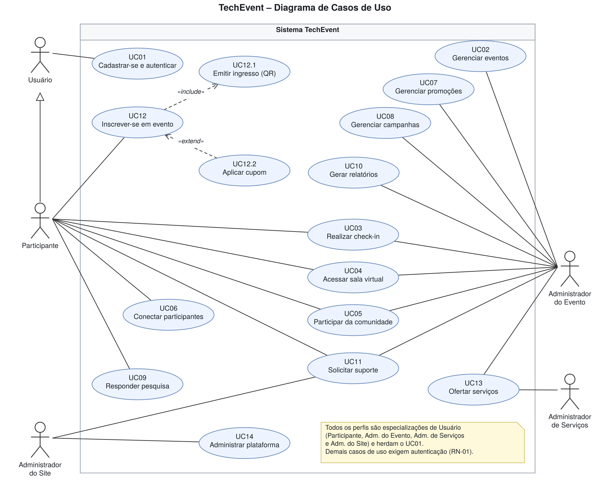

[Abrir no Draw.io (arquivo editável)](../diagramas/01_casos_de_uso.drawio)

*Figura 1 – Diagrama de Casos de Uso do TechEvent*

## 17.4 Diagramas de Sequência

Os diagramas de sequência detalham a troca de mensagens entre a interface (Tela), a camada de controle (Controller) e as entidades do domínio, seguindo o padrão MVC adotado na arquitetura.

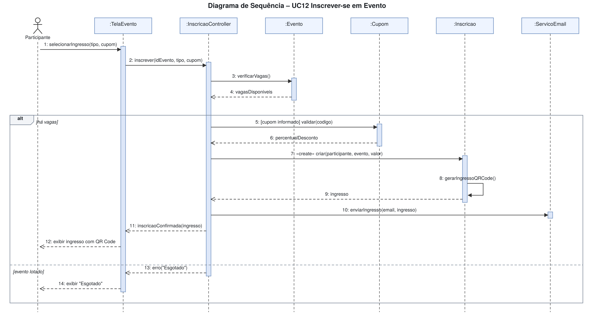

[Abrir no Draw.io (arquivo editável)](../diagramas/02_seq_inscricao.drawio)

*Figura 2 – Sequência – UC12 Inscrever-se em Evento*

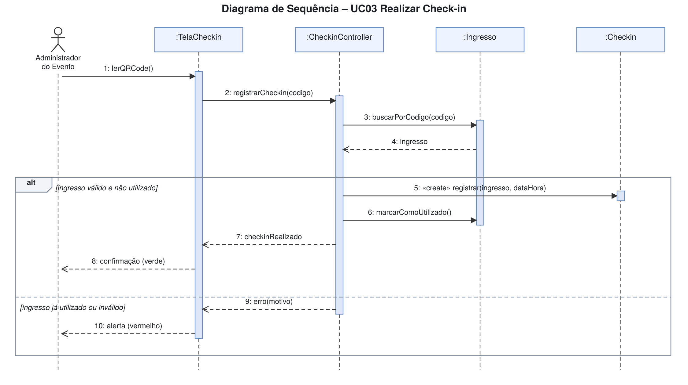

[Abrir no Draw.io (arquivo editável)](../diagramas/03_seq_checkin.drawio)

*Figura 3 – Sequência – UC03 Realizar Check-in*

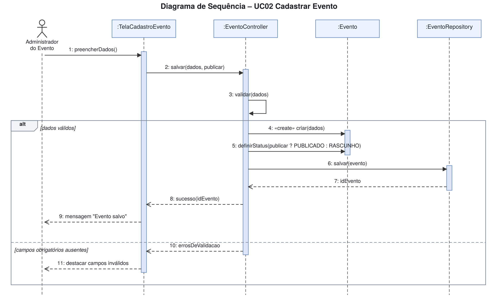

[Abrir no Draw.io (arquivo editável)](../diagramas/04_seq_cadastro_evento.drawio)

*Figura 4 – Sequência – UC02 Cadastrar Evento*

## 17.5 Diagramas de Atividades

Os diagramas de atividades representam o fluxo de trabalho de cada processo, com raias (swimlanes) indicando o responsável por cada ação, decisões com condições de guarda e ações paralelas (fork/join).

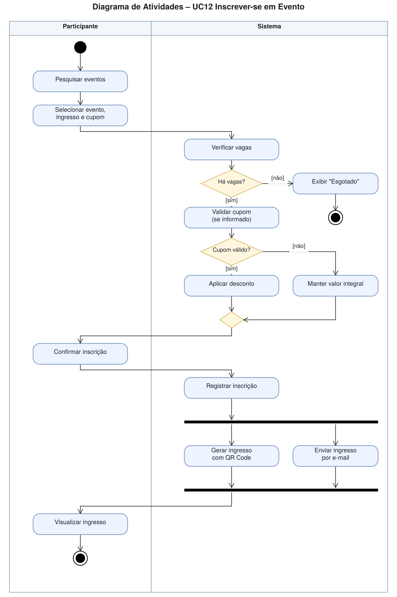

[Abrir no Draw.io (arquivo editável)](../diagramas/05_ativ_inscricao.drawio)

*Figura 5 – Atividades – UC12 Inscrever-se em Evento*

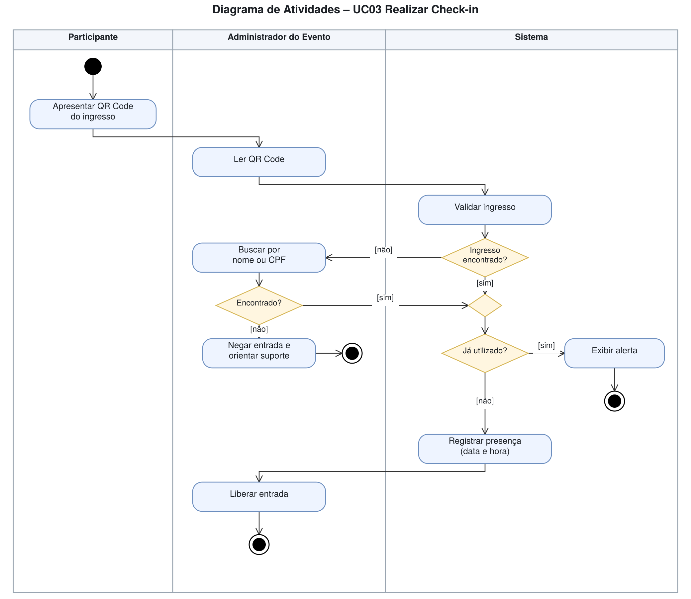

[Abrir no Draw.io (arquivo editável)](../diagramas/06_ativ_checkin.drawio)

*Figura 6 – Atividades – UC03 Realizar Check-in*

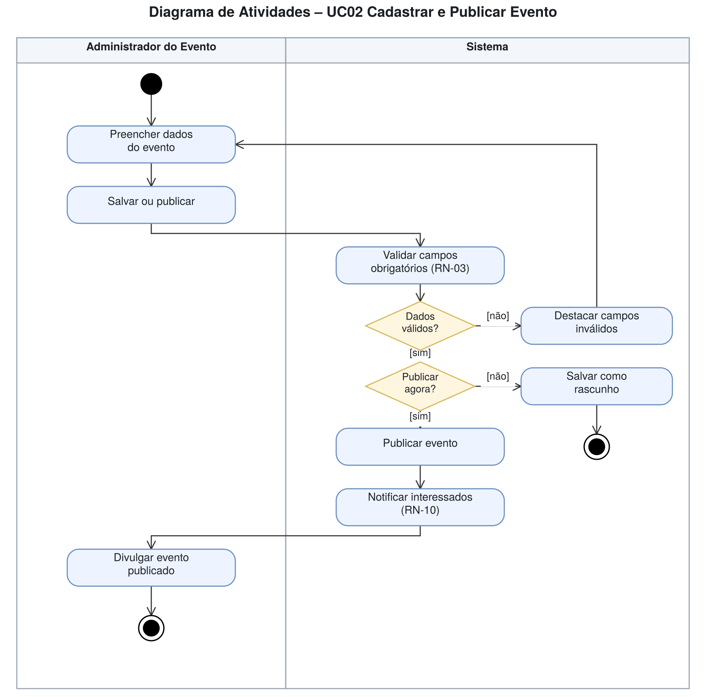

[Abrir no Draw.io (arquivo editável)](../diagramas/07_ativ_cadastro_evento.drawio)

*Figura 7 – Atividades – UC02 Cadastrar e Publicar Evento*

# 18. Modelagem Estrutural

Esta seção corresponde à Fase 3 do projeto e apresenta o modelo de domínio do TechEvent por meio de Diagramas de Classes. Para manter a legibilidade, o modelo foi dividido em duas visões: o Núcleo (usuários, eventos e inscrições) e Engajamento, Suporte e Serviços. As classes de interface (Tela) e de controle (Controller) que aparecem nos diagramas de sequência pertencem às camadas de apresentação e aplicação e são tratadas na especificação de arquitetura (Fase 4).

## 18.1 Decisões de Modelagem

- **Herança:** Participante, AdministradorEvento, AdministradorServicos e AdministradorSite especializam a classe abstrata Usuario, que concentra autenticação e dados pessoais (RF-01, RNF-05).

- **Composição:** TipoIngresso, SalaVirtual e Comunidade só existem dentro de um Evento; Ingresso só existe dentro de uma Inscricao; Publicacao pertence a uma Comunidade e RespostaPesquisa a uma PesquisaPosEvento. Excluir o todo exclui as partes.

- **Associações com multiplicidade:** um Participante realiza 0..\* inscrições; um Evento recebe 0..\* inscrições; uma Inscricao usa no máximo um Cupom (RN-05); um Ingresso gera no máximo um Checkin (RN-06).

- **Enumerações:** os estados de Evento e Inscricao e o formato do evento são enumerações, o que impede valores inválidos e documenta o ciclo de vida.

- **Encapsulamento:** todos os atributos são privados (-) e o acesso é feito por métodos públicos (+), que implementam as regras de negócio (ex.: Cupom.validar(), Evento.verificarVagas()).

- **Relatorio:** é um objeto de transferência gerado sob demanda a partir dos dados de inscrições, check-ins e pesquisas; por não ser persistido, não aparece como entidade do domínio.

## 18.2 Dicionário de Classes

| **Classe**                                   | **Responsabilidade**                                                                                          | **Requisitos**        |
|----------------------------------------------|---------------------------------------------------------------------------------------------------------------|-----------------------|
| Usuario (abstrata)                           | Dados comuns de identificação, autenticação, interesses e consentimento LGPD; superclasse de todos os perfis. | RF-01                 |
| Participante                                 | Usuário que se inscreve, faz check-in, acessa salas virtuais, interage e responde pesquisas.                  | RF-03, 05, 06, 09, 12 |
| AdministradorEvento                          | Organiza eventos, promoções, campanhas e consulta relatórios.                                                 | RF-02, 07, 08, 10     |
| AdministradorServicos                        | Fornecedor parceiro que oferta serviços para eventos; precisa ser aprovado.                                   | RF-13                 |
| AdministradorSite                            | Gerencia usuários, aprova fornecedores, modera conteúdo e atende chamados.                                    | RF-11, RF-14          |
| Evento                                       | Entidade central: dados, formato, capacidade e ciclo de vida (StatusEvento).                                  | RF-02                 |
| TipoIngresso                                 | Categoria de ingresso de um evento (nome, preço e quantidade). Composição de Evento.                          | RF-02, RF-12          |
| Inscricao                                    | Vínculo entre Participante e Evento, com valor pago e status.                                                 | RF-12                 |
| Ingresso                                     | Ingresso digital com QR Code gerado pela inscrição. Composição de Inscricao.                                  | RF-12, RF-03          |
| Checkin                                      | Registro de presença (data, hora e modo QR ou manual). No máximo um por ingresso (RN-06).                     | RF-03                 |
| Cupom                                        | Desconto percentual com validade e limite de usos (RN-05).                                                    | RF-07                 |
| SalaVirtual                                  | Ambiente on-line do evento, liberado 15 min antes do início (RN-07).                                          | RF-04                 |
| Comunidade / Publicacao                      | Espaço de interação do evento e as publicações dos participantes (RN-08).                                     | RF-05                 |
| Conexao                                      | Conexão (match) entre dois participantes: solicitante e convidado.                                            | RF-06                 |
| Campanha                                     | Campanha de marketing segmentada por interesse, com métricas (RN-10).                                         | RF-08                 |
| PesquisaPosEvento / RespostaPesquisa         | Questionário de satisfação e respostas dos participantes (RN-11).                                             | RF-09                 |
| Chamado                                      | Solicitação de suporte com protocolo e status.                                                                | RF-11                 |
| Servico                                      | Serviço ofertado por fornecedor; pode receber pedidos de orçamento.                                           | RF-13                 |
| StatusEvento, FormatoEvento, StatusInscricao | Enumerações com os valores permitidos para os atributos de estado.                                            | —                     |

## 18.3 Diagrama de Classes – Núcleo

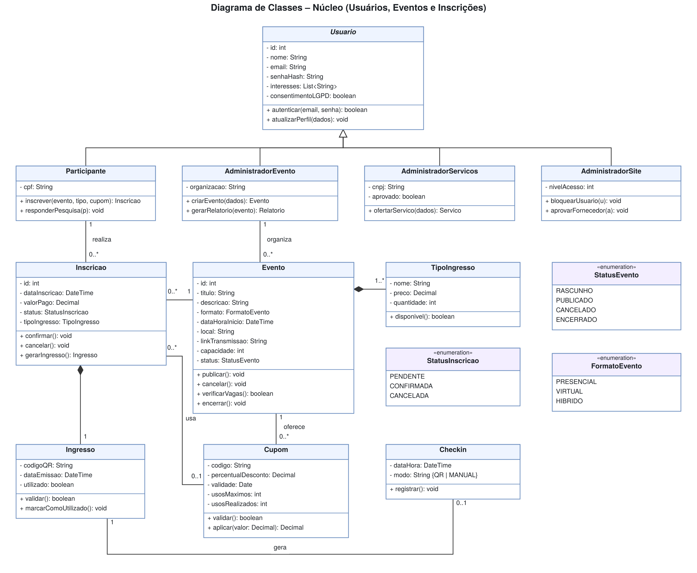

[Abrir no Draw.io (arquivo editável)](../diagramas/08_classes_nucleo.drawio)

*Figura 8 – Diagrama de Classes – Núcleo (Usuários, Eventos e Inscrições)*

## 18.4 Diagrama de Classes – Engajamento, Suporte e Serviços

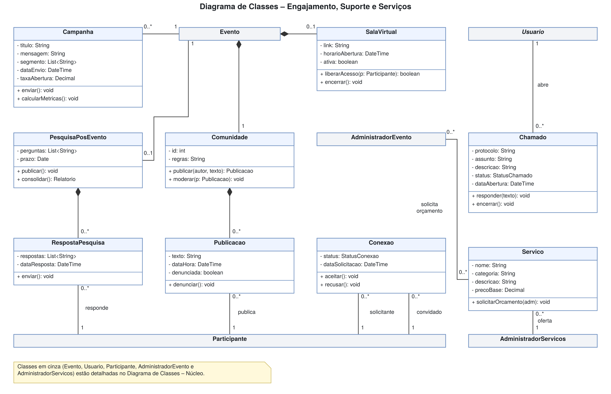

[Abrir no Draw.io (arquivo editável)](../diagramas/09_classes_engajamento.drawio)

*Figura 9 – Diagrama de Classes – Engajamento, Suporte e Serviços*

# 19. Interface – Protótipos de Tela (Wireframes)

Esta seção corresponde à primeira parte da Fase 4. Os wireframes foram elaborados no Figma em baixa fidelidade (tons de cinza), priorizando a estrutura das telas, a hierarquia das informações e o fluxo de navegação, e não o acabamento visual. As telas foram montadas com componentes reutilizáveis — Navbar, Botão primário e secundário, Campo de formulário, Card de evento, Chip de filtro e Placeholder de imagem — o que garante consistência entre as telas e facilita a evolução para protótipos de alta fidelidade.

Arquivo no Figma: [<u>TechEvent – Wireframes</u>](https://www.figma.com/design/ztU70eN4dT5YdoTDUbIA5B)

## 19.1 Telas e Rastreabilidade

| **Tela**               | **Perfil**     | **Caso de uso** | **Requisitos** | **Destaques**                                            |
|------------------------|----------------|-----------------|----------------|----------------------------------------------------------|
| 01 Login e cadastro    | Usuário        | UC01            | RF-01, RNF-05  | Aceite dos termos (LGPD) e recuperação de senha          |
| 02 Busca de eventos    | Participante   | UC12            | RF-02, RF-12   | Busca por texto e filtros de data, categoria e formato   |
| 03 Detalhe e inscrição | Participante   | UC12, UC12.2    | RF-07, RF-12   | Tipos de ingresso, cupom (RN-05) e vagas (RN-04)         |
| 04 Ingresso            | Participante   | UC12.1          | RF-12          | QR Code, download em PDF e agenda                        |
| 05 Check-in            | Adm. do Evento | UC03            | RF-03          | Leitura do QR, busca manual e alerta de reuso (RN-06)    |
| 06 Cadastro de evento  | Adm. do Evento | UC02            | RF-02          | Campos obrigatórios (RN-03), rascunho ou publicação      |
| 07 Relatórios          | Adm. do Evento | UC10            | RF-09, RF-10   | Indicadores, comparecimento, satisfação e exportação PDF |
| 08 Sala virtual        | Participante   | UC04            | RF-04          | Transmissão ao vivo, chat e perguntas (RN-07)            |

## 19.2 Diretrizes de Usabilidade e Acessibilidade

- **Navegação consistente:** a mesma barra de navegação em todas as telas, com links que mudam conforme o perfil (participante ou organizador).

- **Uma ação principal por tela:** o botão primário (escuro) indica o próximo passo; ações secundárias usam botão com contorno.

- **Feedback imediato:** mensagens de sucesso e de alerta aparecem no contexto da ação, como a confirmação do check-in e o aviso de ingresso já utilizado.

- **Rótulos visíveis:** todos os campos têm rótulo acima da caixa, e não apenas texto de exemplo, conforme as diretrizes WCAG (RNF-03).

- **Fluxo curto de inscrição:** busca → detalhe → escolha do ingresso e cupom → inscrever-se → ingresso, em 4 passos, atendendo ao RNF-08 (até 5 passos).

- **Responsividade:** as telas usam grade e componentes flexíveis, adaptáveis a celulares (RNF-06).

## 19.3 Telas

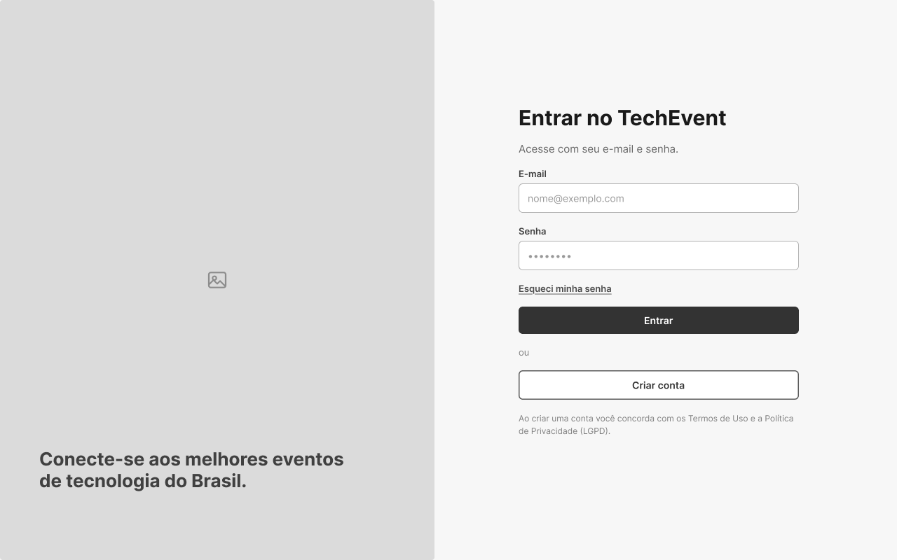

*Figura 10 – Wireframe – 01 Login e cadastro (UC01)*

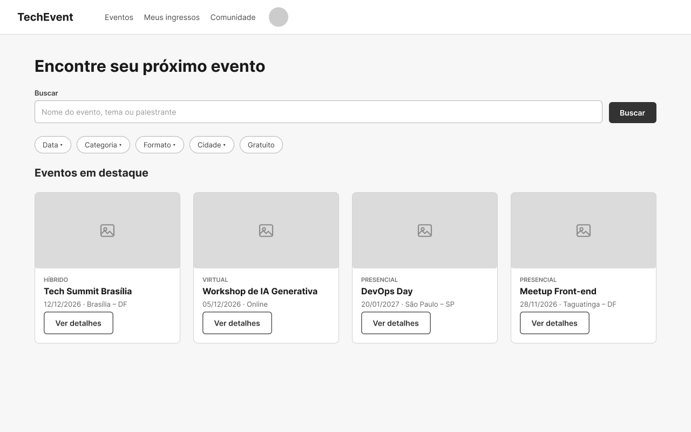

*Figura 11 – Wireframe – 02 Busca de eventos (UC12)*

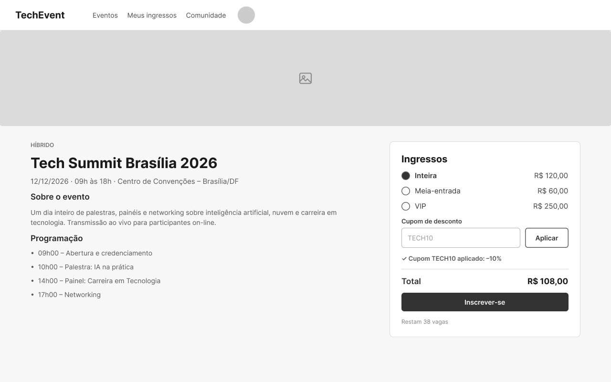

*Figura 12 – Wireframe – 03 Detalhe e inscrição (UC12, UC12.2)*

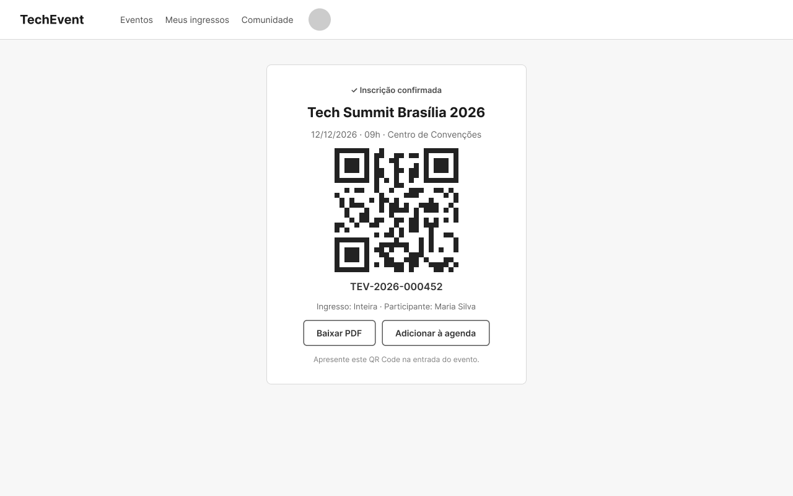

*Figura 13 – Wireframe – 04 Ingresso (UC12.1)*

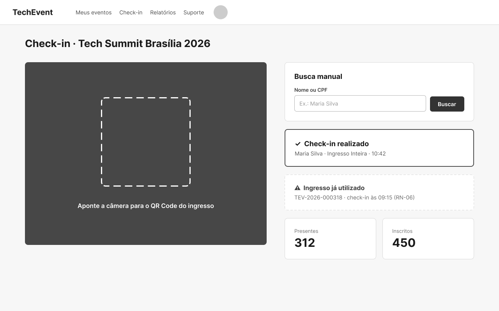

*Figura 14 – Wireframe – 05 Check-in (UC03)*

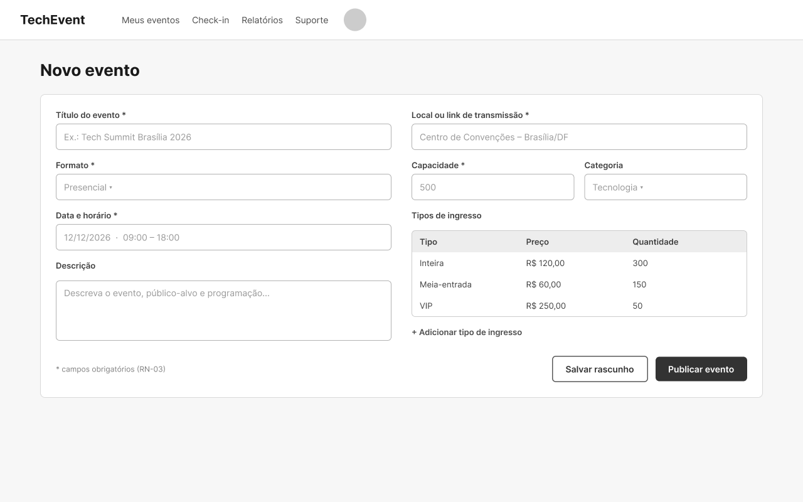

*Figura 15 – Wireframe – 06 Cadastro de evento (UC02)*

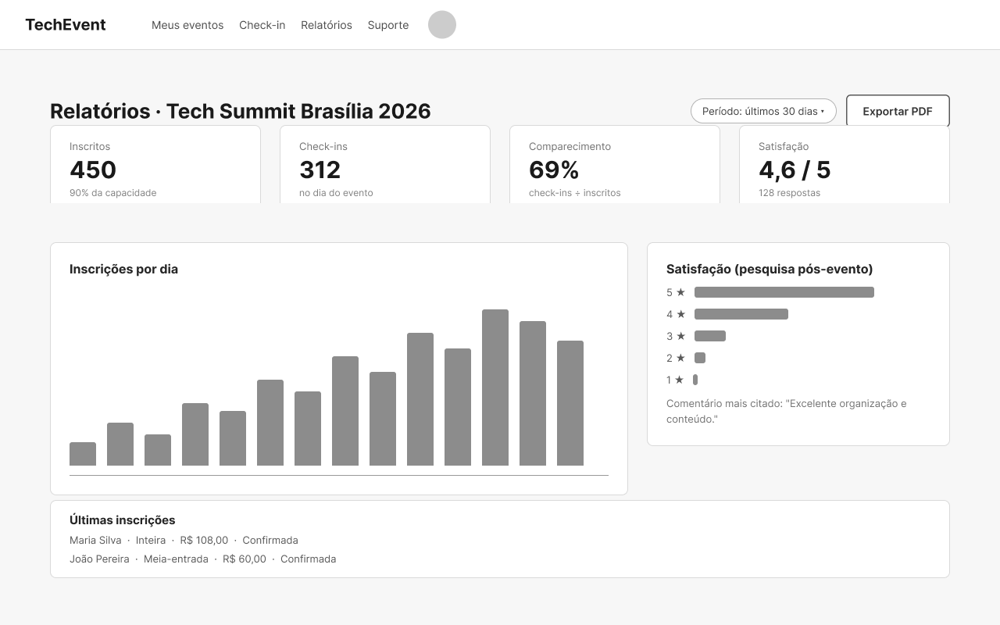

*Figura 16 – Wireframe – 07 Relatórios (UC10)*

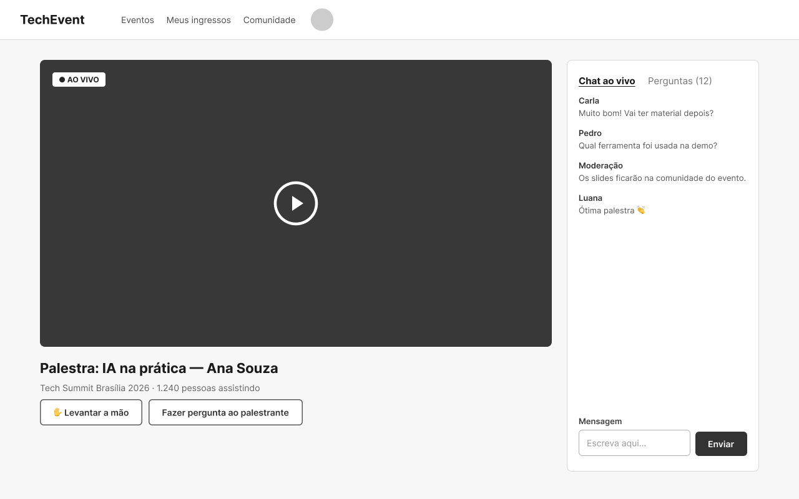

*Figura 17 – Wireframe – 08 Sala virtual (UC04)*

# 20. Especificação de Arquitetura

Esta seção completa a Fase 4. O TechEvent adota uma arquitetura cliente-servidor em camadas: a interface é uma aplicação web responsiva (SPA) executada no navegador, que se comunica por HTTPS com uma API REST. No servidor, o código é organizado segundo o padrão MVC, complementado pelas camadas de Serviço e de Persistência, o que mantém a mesma estrutura usada nos diagramas de sequência (Tela → Controller → Entidade) e no diagrama de classes. O diagrama de arquitetura e o mapa do site estão nas seções 20.6 e 20.7.

## 20.1 Camadas e Responsabilidades

| **Camada**                | **Responsabilidade**                                                          | **Elementos do modelo**                                  |
|---------------------------|-------------------------------------------------------------------------------|----------------------------------------------------------|
| Apresentação (View)       | Exibe as telas, valida formulários e consome a API REST.                      | Telas 01 a 08 (TelaEvento, TelaCheckin…)                 |
| Controle (Controller)     | Recebe as requisições HTTP, valida a entrada, chama o serviço e devolve JSON. | InscricaoController, CheckinController, EventoController |
| Serviço (Service)         | Implementa as regras de negócio e controla as transações.                     | InscricaoService (RN-04, RN-05), CheckinService (RN-06)  |
| Domínio (Model)           | Entidades com seus dados e comportamentos.                                    | Classes da seção 18                                      |
| Persistência (Repository) | Acesso ao banco de dados, isolado das regras de negócio.                      | EventoRepository, InscricaoRepository…                   |

## 20.2 Padrões de Projeto

| **Padrão**         | **Onde é aplicado**                                                   | **Benefício**                                            |
|--------------------|-----------------------------------------------------------------------|----------------------------------------------------------|
| MVC (arquitetural) | Separação entre Telas, Controllers e Modelo                           | Facilita manutenção, testes e trabalho em paralelo       |
| Repository         | EventoRepository, InscricaoRepository…                                | Isola o acesso a dados; troca de banco sem afetar regras |
| Service Layer      | InscricaoService, CheckinService…                                     | Centraliza as regras de negócio em um só lugar           |
| DTO                | EventoDTO, InscricaoDTO, Relatorio                                    | Não expõe entidades na API; trafega só o necessário      |
| Strategy           | Cálculo de desconto e modo de check-in (QR ou manual)                 | Novas regras sem alterar o código existente              |
| Observer           | Publicação de evento e confirmação de inscrição disparam notificações | Desacopla NotificacaoService das demais regras           |
| Factory            | Criação de Ingresso com QR Code                                       | Centraliza e padroniza a criação de objetos              |
| Singleton          | Configurações e pool de conexões (gerenciados pelo Spring)            | Uma única instância compartilhada                        |

## 20.3 Tecnologias

| **Componente**        | **Tecnologia**                                                        |
|-----------------------|-----------------------------------------------------------------------|
| Front-end             | React + TypeScript, HTML5 e CSS responsivo                            |
| Back-end              | Java 21 + Spring Boot (Web, Security, Data JPA)                       |
| Banco de dados        | PostgreSQL                                                            |
| Autenticação          | JWT e senhas com hash BCrypt                                          |
| QR Code               | Biblioteca ZXing (geração e leitura)                                  |
| E-mail e notificações | SMTP / SendGrid                                                       |
| Sala virtual          | Integração com plataforma de streaming (WebRTC)                       |
| Infraestrutura        | Contêineres Docker em nuvem, com HTTPS                                |
| Qualidade             | Testes com JUnit (back-end) e Jest (front-end); CI com GitHub Actions |
| Gestão e documentação | Trello, Draw.io, Figma, Git/GitHub e Markdown                         |

## 20.4 Atendimento aos Requisitos Não Funcionais

| **Requisito**          | **Solução arquitetural**                                                                               |
|------------------------|--------------------------------------------------------------------------------------------------------|
| RNF-01 Desempenho      | Paginação nas listagens, índices no banco, cache de consultas frequentes e CDN para arquivos estáticos |
| RNF-02 Segurança       | HTTPS/TLS, JWT, senhas com BCrypt e autorização por perfil (Spring Security)                           |
| RNF-03 Acessibilidade  | HTML semântico, contraste adequado, navegação por teclado e rótulos visíveis                           |
| RNF-04 Disponibilidade | Réplicas dos contêineres, monitoramento e backups diários do banco                                     |
| RNF-05 LGPD            | Consentimento explícito, exclusão de conta, minimização de dados e logs de auditoria                   |
| RNF-06 Compatibilidade | Layout responsivo e testes nos navegadores suportados                                                  |
| RNF-07 Escalabilidade  | Servidor sem estado (JWT) permite escalonamento horizontal em eventos grandes                          |
| RNF-08 Usabilidade     | Fluxo de inscrição em 4 passos, validado nos wireframes                                                |

## 20.5 Segurança e Proteção de Dados

- Toda comunicação entre navegador e servidor é criptografada (HTTPS/TLS).

- Após o login, o servidor emite um token JWT com prazo de validade; cada requisição é autorizada conforme o perfil do usuário.

- Senhas nunca são armazenadas em texto: apenas o hash BCrypt.

- Dados pessoais são usados somente com consentimento (RN-10), e o usuário pode solicitar a exclusão da conta (RNF-05).

- Ações administrativas e acessos a dados pessoais são registrados em log de auditoria.

## 20.6 Diagrama de Arquitetura

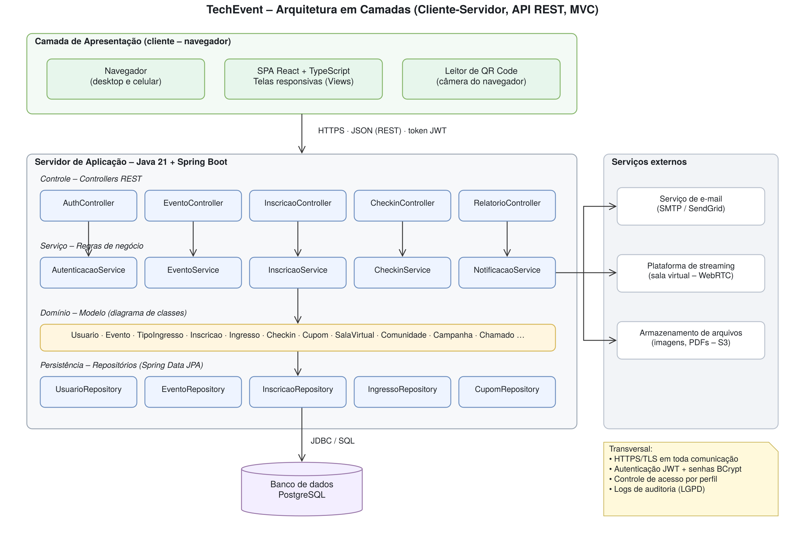

[Abrir no Draw.io (arquivo editável)](../diagramas/10_arquitetura.drawio)

*Figura 18 – Arquitetura em camadas do TechEvent*

## 20.7 Mapa do Site

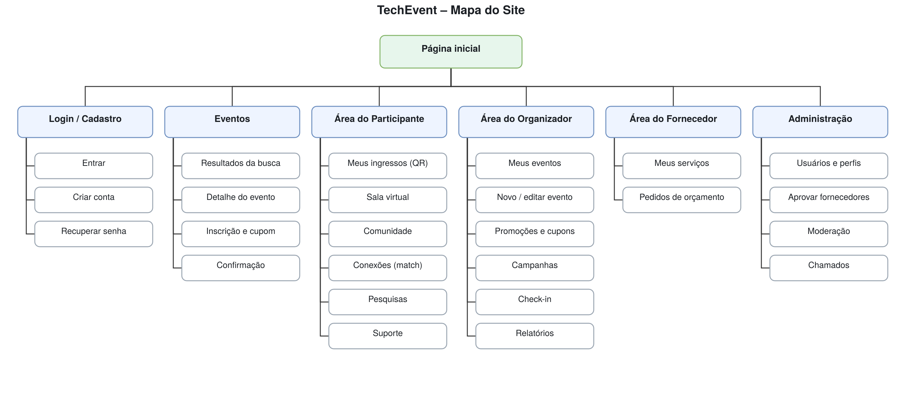

[Abrir no Draw.io (arquivo editável)](../diagramas/11_mapa_do_site.drawio)

*Figura 19 – Mapa do site do TechEvent*
